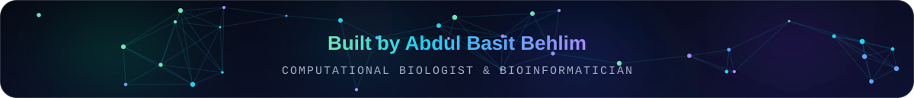

  

  
  
  

## What it is

Basit Hub is my browser start page. I open it every morning, and it puts everything I need for a day of computational biology in one place: genomics, protein structure, molecular docking, simulation and machine learning.

It is a single HTML file with no build step, so you can copy it and make it yours.

  

## Features

| | |
|---|---|
| **Greeting and clock** | A time-based greeting, live clock, date, and a bar showing how much of the day has passed |
| **3D protein of the day** | Rendered with 3Dmol.js. Switch between cartoon, surface and stick views, toggle spinning, or load any structure by its PDB ID |
| **DNA double helix** | An animated helix coloured by nucleotide (A, T, G, C) |
| **One search bar** | Google, Google Scholar, PubMed, UniProt, RCSB PDB, AlphaFold DB, NCBI, PubChem, arXiv, Hugging Face and GitHub. A 4-character PDB ID opens the structure page directly |
| **Quick links** | Grouped into Genomics, Proteins, Docking and Machine learning |
| **AI assistants** | ChatGPT, Claude, Gemini, Copilot, Perplexity, DeepSeek, Grok, Meta AI and Le Chat, plus research tools such as AlphaFold Server, NotebookLM, Elicit, Consensus and SciSpace |
| **Google apps** | Gmail, Drive, Docs, Sheets, Slides, Calendar, Meet, Colab, Scholar and more |
| **Lab notes** | Notes that save automatically in your browser |
| **Daily tip** | A short reminder on docking, molecular dynamics or machine-learning practice |
| **Glass design** | Light and dark themes in the same colour gradient as my GitHub profile, with a layout that adapts to phones |

## Use it as your start page

### Desktop

- **Chrome:** Settings → On startup → Open a specific page → Add a new page → paste the live link.
- **Edge:** Settings → Start, home, and new tabs → Open these pages → Add a new page → paste the live link.
- **Firefox:** Settings → Home → Homepage and new windows → Custom URLs → paste the live link.

To show it on every new tab, use an extension such as *Custom New Tab URL* (Chrome, Edge) or *New Tab Override* (Firefox).

### Mobile

- **Chrome on Android:** ⋮ → Settings → Homepage → paste the live link.
- **Samsung Internet:** ☰ → Settings → Homepage → Custom.
- **iPhone (Safari):** open the live link → Share → Add to Home Screen.

## Make it yours

Everything lives in one file, `index.html`.

| To change | Edit |
|---|---|
| **Links** | The `<a href="...">` lines inside the link group sections |
| **Daily tips** | The `tips` list in the script |
| **Structures of the day** | The `structures` list, using any PDB ID and a short title |
| **Colours** | The colour variables at the top of the `<style>` block |

## Built with

- Plain HTML, CSS and JavaScript, with no build step
- [3Dmol.js](https://3dmol.csb.pitt.edu/) for molecular visualisation
- Structure files from the [RCSB Protein Data Bank](https://www.rcsb.org/)
- [Bricolage Grotesque](https://fonts.google.com/specimen/Bricolage+Grotesque) and [JetBrains Mono](https://fonts.google.com/specimen/JetBrains+Mono) from Google Fonts
- Hosted on GitHub Pages

The 3D viewer and fonts need an internet connection. Everything else works offline.

## License

The code is released under the [MIT License](LICENSE). The profile photo in `index.html` is personal and is not covered by this license; please do not reuse it.

  

